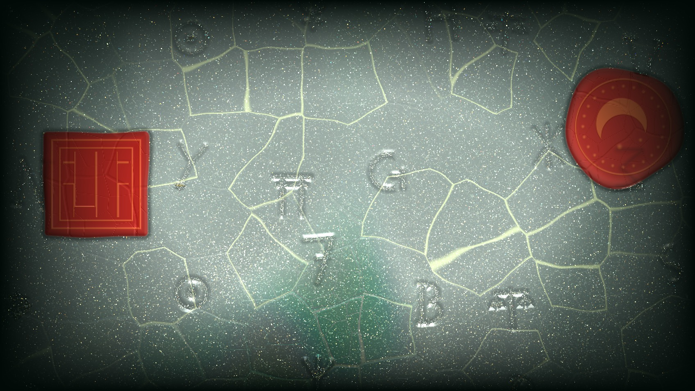
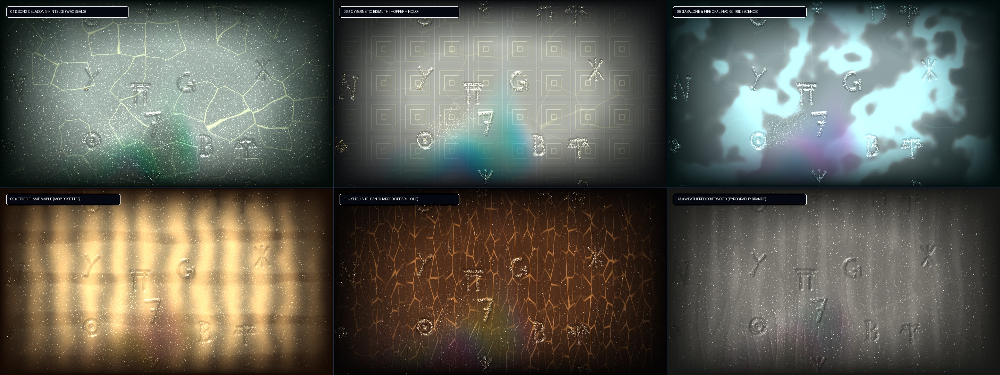
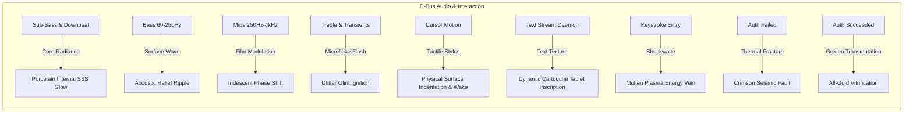

# Archetype 09: The Embossed Glyph Matrix (Chrono-Glyph Bas-Relief & Shifting Materials)

## 1. Aesthetic Vision
A mesmerizing, architectural bas-relief monolith wall scrolling gently across the screen, engraved with a vast, borderless field of **organically scattered esoteric glyphs, ancient runes, classical multi-font letters, and real-time command text (e.g. `fortune`)**.

Rather than a rigid tile grid or a static stone carving:
* **Organic Non-Grid & Guaranteed Clearance (No Overlaps)**: Glyphs are distributed with natural randomized jittering across a 3x3 cellular neighborhood without rectangular tile borders or visible grid seams. Bounded jitter and proportional cell scaling mathematically guarantee that adjacent glyphs **never overlap or touch**.
* **Upright Epigraphic Alignment**: All procedural glyphs are strictly aligned right-side up, perfectly matching the orientation of standard text.
* **Golden Ratio Portrait Quote Inscriptions (No Border)**: Real-time quotes from fortune or custom sources dynamically adapt an enclosing area proportioned strictly to the **golden ratio in portrait mode** ($1 : 1.618$), adjusting to the smallest footprint that comfortably holds the quote without clipping. All artificial borders and frame rims have been removed, presenting pure, chiseled monumental typography.
* **Guaranteed Quote Clearance (No Gaping Dead Space)**: The dynamic portrait golden ratio quote area ($1 : 1.618$) tightly encloses the fortune text with zero wasted black margins. Procedural glyphs are excluded strictly by their outer bounding radius, causing runes and glyphs to hug the inscribed quote snugly without leaving empty deserts of blank stone.
* **Rich Variety of Fonts & Weights**:
  * *Procedural Glyphs*: 24 glyphs across 6 distinct typographic styles (Classical Antiqua, Modernist Sans, Greek Epigraphic, Elder Futhark runes, Cuneiform, Alchemical sigils) with dynamic stroke weights ranging from delicate hairline ($0.015$) to extra bold / black ($0.033$).
  * *Fortune Inscriptions*: Cycles through curated typographic profiles (Classical Antiqua, Editorial Didone, Monumental Grotesque, Humanist Book Serif, Lapidary Epigraphic, Technical Monospace) with varying weights (`Light`, `Normal`, `Medium`, `Bold`, `Black`), letter-spacing, and line heights.
* **Configurable Spacing & Zoom**: Independent user sliders for **Glyph Spacing** ($0.6\times - 2.5\times$) and **Field Zoom Scale** ($0.4\times - 2.5\times$) to seamlessly transition from dense, intimate glyph studies to panoramic vistas.
* **Persistent Medallions, Artisanal Seals & Holographic Stickers (32 Designs Across 5 Physical Craft Media)**:
  * Every one of the **13 curated themes** pairs its procedural substrate with a material-authentic persistent medallion style (`sealStyle` 0..4), freely overlapping embossed glyphs, substrates, and chiseled quotes:
    * **Style 0 — Holographic Security Foil Stickers (8 designs, 3 optical foil modes)**: Multi-order Kirchhoff CD diffraction foil, Deliot & Belcour diamond-dust glitter vinyl, and hybrid badges (*Lapislazuli, Volcanic Obsidian, Cybernetic Bismuth, Hammered Platinum, Abalone & Fire Opal, Shou Sugi Ban, Workshop Pine*).
    * **Style 1 — Crimson Cinnabar Wax / *Rakkan* Seals (6 designs)**: Square *tensho* chop, 8-petal lotus, endless knot, crescent moon & stars, 16-petal *kiku*, and double-lobed gourd stamp with organic wax-drip edge wobble and warm wax SSS (*Song Celadon & Kintsugi Porcelain*).
    * **Style 2 — Flush Brushed Metal / *Maki-e* / *Pietra Dura* Inlays (6 designs)**: Florentine compass, Art Deco sunburst, 8-fold *Rub el Hizb* rosette, Byzantine cross, armillary astrolabe, and Roman laurel lozenge (*Tenmoku Oil-Spot Ceramic, Carrara Marble & Rose Gold, Burl Walnut & French Polish*).
    * **Style 3 — Luthier Mother-of-Pearl & Abalone Rosettes (6 designs)**: Classical guitar rosette, fretboard split-diamond crown, tendril scroll, Art Nouveau wings, Celtic triquetra, and baroque fleur-de-lis with Belcour & Barla thick-film iridescence and ebony purfling (*Tiger-Flame Maple Lutherie*).
    * **Style 4 — Hot-Iron Pyrography Wood Brands (6 designs)**: Maritime anchor, Nordic wayfinder staves, cooperage barrel mark, alpine peaks & conifer, blacksmith shield, and antler solar crest scorched deeply into the wood grain (*Weathered Silver Driftwood*).
  * **Off-Screen Generation & Continuous Persistence (Zero Mid-Screen Popping)**:
    * Medallions are **never spawned or deleted in the middle of the screen**.
    * As the slab scrolls from bottom-right towards top-left, candidate grid cells are evaluated as they cross the off-screen entry boundary ($uv \in [0.95, 1.25]$) and stamped with the active theme's `sealStyle`.
    * Once affixed, each physical medallion **persists continuously in its own craft medium across subsequent theme transitions** (e.g., a cinnabar wax seal or mother-of-pearl rosette stays intact even as the slab morphs into a new substrate) until it scrolls completely past the exit edges ($uv < -0.25$).
* **Scroll-Synchronized Quote Transitions (Zero In-View Popping)**:
  * Quote updates are no longer governed by a blind timer. Instead, the QML engine tracks the exact vertical phase of the quote in scrolling material space:
    $$\text{quoteCoord}_y = (1.9 \times \text{zoom} + \text{scrollVec}_y) \times 0.055 + 0.45$$
  * While on screen ($\text{quotePhase} \in [0.23, 0.77]$), the inscribed tablet remains completely rock-solid and stable.
  * The exact instant the old quote scrolls past the top edge of the screen ($\text{quotePhase} > 0.77$), the engine triggers a background update.
  * A fresh fortune is loaded, the font profile and weight are cycled, and the next tablet arrives from the bottom edge bearing a **brand new fortune**.
* **Live Fortune Generation Pipeline**:
  * *Interactive Harness*: `tools/harness/runner.py` directly executes `/usr/games/fortune -s` (or user custom command) on demand via Python subprocess and atomic IPC, feeding fresh quotes in real-time.
  * *KDE Plasma Session*: `crates/regel-daemon` automatically spawns a lightweight background thread updating `/tmp/regel_fortune.txt` every 12 seconds with atomic file swap.
  * *Built-in Curated Philosophical Deck*: 42 diverse quotes from Marcus Aurelius, Seneca, Rumi, Dickinson, Einstein, Feynman, Sagan, Borges, Blake, Shelley, Nietzsche, Emerson, Thoreau, Watts, and more, guaranteeing rich, continuous variety even when `fortune` is not installed.
* **Randomized Embossing & Debossing**: Individual glyphs and text passages are distributed randomly between **embossed** (raised, convex plateau catching light from above) and **debossed** (sunken, engraved intaglio casting shadows within the groove).
* **Affixed Material Textures**: All material textures—microflake metallic glitter, rock grain, porcelain veins, and iridescent oil-slick patches—are locked to the material coordinates, scrolling in rigid lockstep with the physical monolith.
* **4× Expanded Scroll Speed**: Full velocity slider range expanded from `0.1` up to `8.0` for everything from geological tectonic drift to rapid stream reading.
* **Continuous Theme Auto-Cycling**: Material themes smoothly morph into one another at a configurable interval (seconds), cross-fading colors, glitter, and holographic optical characteristics with seamless ease.

---

## 2. Event-to-Effect Mapping

### Complete Event Matrix

| Event / Signal | Physical Telemetry Reaction | Optical & Material Metaphor |
| :--- | :--- | :--- |
| **Idle Ambient Drift** | Slow, hypnotic diagonal creeping scroll ($v \in [0.1..8.0]$). Microflakes, stone micrograin, and material veins move in lockstep with the carved relief. | Geological time lapse; solid stone slab translation. |
| **Mouse Hover & Cursor Sweeps** | The cursor acts as a pressure stylus: it physically indents the stone/porcelain surface (smooth Gaussian depression) and leaves a fluid trailing wake along the velocity vector, naturally catching ambient directional light without blinding glare. | Sculptor pressing a stylus or thumb into pliable porcelain and clay. |
| **Sub-Bass & Bass Cadence** | Bass energy gently supports the monolith's natural kinetic drift velocity without any full-screen luminance strobing, normal vibration, or lighting flashes. | Tranquil geological stability; steady tectonic motion. |
| **Mids & Singing Vocal Energy** | Vocal frequencies enrich chromatic depth within holographic and thin-film layers with smoothly filtered transitions, preserving steady overall ambient lighting. | Natural chromatic resonance with zero global flicker. |
| **Treble & Microflake Glints** | Microflakes catch specular glints strictly through directional light geometry as facets align, maintaining calm, steady ambient illumination. | Crystalline mineral flakes embedded in solid stone. |
| **Live Fortune & Tablet Inscriptions** | Queries `/usr/games/fortune -s` (or user command/custom text) and renders the quote and author into a dynamic cartouche tablet with proportional sizing and word-wrap. | Ancient stone stelae bearing living prophetic inscriptions. |
| **Lock Screen Keystroke (`onKeyStroke`)** | Each keypress radiates a circular shockwave ripple that displaces the relief height and charges the engraved glyph crevices with luminescent plasma energy veins. | Energetic conduit ignition through carved runes. |
| **Authentication Failure (`onAuthFailed`)** | A violent crimson shockwave detonates across the monolith, shattering the porcelain glaze and filling the glyph engravings with smoldering amber fault lines. | Seismic rupture of a sacred architectural stele. |
| **Authentication Success (`onAuthSucceeded`)** | The entire monolith transmutes into high-karat gilded vitreous enamel, accelerating smoothly to clear into the user's desktop. | Alchemical transmutation and aperture dissolution. |

---

## 3. Shader & Physical Optics Architecture

### Borderless Jittered Glyph Evaluation
The shader evaluates a 3x3 cellular neighborhood around each point. Each cell has an independent pseudo-random position jitter ($\pm 0.28$), scale ($0.55\times - 0.71\times$), tilt angle ($\pm 8^\circ$), stroke weight ($0.015 - 0.033$), glyph ID ($0..107$), and emboss sign ($\pm 1.0$). By avoiding any bounding cell frames, the glyphs float organically across the monolith.

### Expanded Procedural SDF Library (108 Distinct Glyphs)
The procedural signed distance field engine incorporates **108 distinct glyphs** spanning diverse historical fonts, technical scripts, mathematical symbols, and tactile emojis. Every glyph is dynamically scalable, supports continuous stroke weight morphing (hairline to heavy black), and can be embossed (raised with gilded inlay) or debossed (sunken chiseled relief).

#### 1. Classical Roman Serif & Modern Technical Sans-Serif (IDs 0..28)
* **Serif Letters (IDs 0..15)**: **A** (apex & foot serifs), **B** (dual bracketed bowls), **C** (terminal serifs), **D** (fluted stem & arch), **E** (slab serifs), **G** (spur & pilaster), **M** (twin pilasters & apex), **N** (diagonal spine), **Q** (calligraphic tail), **R** (flared diagonal leg), **S** (curved spine), **T** (crossbar & serifs), **V** (chiseled apex), **W** (interlaced chevrons), **Z** (slab terminals), **&** (typographic ampersand).
* **Technical Sans-Serif & Digits (IDs 16..28)**: **F**, **H**, **J**, **K**, **L**, **P**, **U**, **X**, **Y**, **1**, **4**, **7**, **8** (clean geometric strokes with orthogonal terminals).

#### 2. Historic Scripts: Fraktur, Greek, Runes & Cyrillic (IDs 29..58)
* **Blackletter / Fraktur Epigraphy (IDs 29..36)**: **𝕬**, **𝕭**, **𝕯**, **𝕱**, **𝕲**, **𝕳**, **𝖄**, **𝖅** (diamond lozenges, ribbed verticals, and Gothic cusps).
* **Greek Epigraphic Typography (IDs 37..46)**: **$\Omega$** (Omega), **$\Psi$** (Psi), **$\Phi$** (Phi), **$\Theta$** (Theta), **$\Sigma$** (Sigma), **$\Lambda$** (Lambda), **$\Xi$** (Xi), **$\Pi$** (Pi), **$\Delta$** (Delta), **$\Gamma$** (Gamma).
* **Elder Futhark Runes (IDs 47..54)**: **ᛉ** (*Algiz* / Elk), **ᛟ** (*Othila* / Heritage), **ᚠ** (*Fehu* / Wealth), **ᛏ** (*Tiwaz* / Sky God), **ᚢ** (*Uruz* / Ox), **ᚦ** (*Thurisaz* / Thorn), **ᚨ** (*Ansuz* / Odin), **ᚲ** (*Kenaz* / Torch).
* **Cyrillic Epigraphy (IDs 55..58)**: **Ж** (Zhe / Butterfly), **Ф** (Ef / Dual Lobe), **Ю** (Yu / Pillar & Circle), **Д** (De / Classical Pediment).

#### 3. Esoteric, Mathematical & Alchemical (IDs 59..80)
* **Ancient Hebrew Epigraphy (IDs 59..64)**: **א** (*Aleph*), **ב** (*Bet*), **ג** (*Gimel*), **ד** (*Dalet*), **ש** (*Shin*), **ת** (*Tav*).
* **Mathematical & Logic Symbols (IDs 65..72)**: **$\infty$** (Infinity), **$\nabla$** (Nabla / Del), **$\partial$** (Partial Derivative), **$\oint$** (Contour Integral), **$\in$** (Element Of), **$\forall$** (For All), **$\exists$** (Exists), **$\angle$** (Angle).
* **Planetary & Alchemical Sigils (IDs 73..80)**: **☉** (Astrological Sun), **☽** (Crescent Moon), **☿** (Alchemical Mercury), **♃** (Jupiter), **♄** (Saturn), **♂** (Mars), **♀** (Venus), **🜂/🜄** (Merkaba / Elemental Transmutation).

#### 4. Emojis & Iconic Emblems (IDs 81..107)
* **81. 👁️ The All-Seeing Eye**: Opposing arc eyelids with central circular iris and pupil dot.
* **82. ⚡ Lightning Bolt**: Jagged 3-stage electrostatic discharge chevron.
* **83. 🌙 Crescent Moon**: Sickle crescent curve with sharp cusp terminals.
* **84. 🪐 Ringed Exoplanet / Saturn**: Spherical body surrounded by an inclined elliptical planetary ring disk.
* **85. ⭐ 5-Point Celestial Star**: Classical faceted 5-pointed star.
* **86. 🗝️ Skeleton Key**: Circular key ring bow, long notched shaft, dual ward bits.
* **87. ⚔️ Crossed Swords**: Dual crossed rapier blades with crossguards and pommels.
* **88. 🛡️ Knight's Shield**: Heraldic heater shield outline with central cross emblem.
* **89. 👑 Imperial Crown**: 5-peaked royal coronet with pearl finial gems.
* **90. 💎 Brilliant Diamond**: Faceted gemstone with crown table and sharp pavilion culet.
* **91. ⌛ Hourglass**: Dual conical glass bulbs with cross-bracing and sand core.
* **92. ⚓ Nautical Anchor**: Top eyelet, stock crossbar, vertical shank, curved flukes with pointed crowns.
* **93. ⚙️ Precision Cogwheel**: Inner hub ring, outer rim, 8 radial gear teeth.
* **94. 🌀 Cosmic Spiral Galaxy**: Logarithmic dual Archimedean spiral arms.
* **95. 🪶 Quill Feather**: Curved rachis shaft with tapered lateral vanes.
* **96. 🕯️ Sacred Candle Flame**: Scribed wick with teardrop flame body.
* **97. 🏹 Archer's Bow & Arrow**: Curved bow stave, taut string, notched arrow with diamond head.
* **98. 🔱 Poseidon's Trident**: Central barbed spear with semicircular cradle and twin outer prongs.
* **99. ❤️ Sacred Heart**: Classical dual-lobed cardiovascular heart with tapered tip.
* **100. 💀 Memento Mori / Skull**: Domed cranium, eye sockets, and chiseled maxillary jaw.
* **101. 🔥 Sacred Fire**: Triple-tongue flame with rising lick peaks.
* **102. 🌱 Seed of Life / Sprout**: Upright stem with dual cotyledon leaves.
* **103. ⚖️ Scales of Justice**: Fulcrum column, horizontal balance beam, dual suspended pans.
* **104. 🧭 Navigator's Compass Rose**: 360° outer ring with 4-point cardinal diamond star.
* **105. 🔮 Divination Crystal Orb**: Glowing sphere atop an arched tripod stand.
* **106. ⛩️ Shinto Torii Gate**: Curved *kasagi* lintel, horizontal *nuki* tie-beam, twin pillars.
* **107. 🧬 DNA Double Helix**: Intertwined helical strands with horizontal base-pair rungs.

### Compact Disc & Holographic Security Sticker Optics
Unlike uniform rainbow washes, real holographic foil stickers combine a reflective metallic mirror substrate with intricate micro-etched diffraction gratings forming crisp vector emblems, security logomarks, and guilloche patterns.

#### 1. High-Contrast Substrate vs. Vector Emblems
* **Substrate (Negative Space)**:
  * **Mode 0 (Pure CD Rainbow Foil)**: High-specular polished silver chrome or imperial gold mirror foil with subtle micro-dot security lattice watermarks.
  * **Mode 1 (Prismatic Glitter Vinyl)**: Sparkling bed of high-density crystalline microflakes featuring multi-spectral rainbow dispersion under a glossy clearcoat dome.
  * **Mode 2 (Hybrid CD + Glitter Vinyl)**: Concentric CD rainbow diffraction tracks projecting sweeping color fans across scintillating prismatic diamond-dust flakes.
* **Graphic Vector Emblems**: Intricately etched diffraction lines that burst with vivid multi-order rainbow light under specular angles, framed by micro-chiseled 3D normal relief bevels (`embH = 0.006`).

#### 2. Procedural Geometric Emblem Library (8 Distinct Vector Designs)
Each sticker shape has its own distinct vector design:
1. **Shape 0: Authenticity Guilloche Rosette & 8-Point Faceted Star (Circular Seal)**:
   * Concentric micro-beaded security rims and outer gear border.
   * Multi-frequency spirograph Guilloche ribbon: $r_g = 0.56 + 0.11 \sin(8\theta + 1.6 \sin 16\theta)$.
   * Inner seal border with micro-teeth, enclosing a faceted 8-point geometric star and central circumpunct.
2. **Shape 1: Cybernetic IC Processor Die & PCB Circuit Bus (Security Badge)**:
   * Dual outer security borders with corner optical registration reticles (L-brackets) and micro-barcode stripes.
   * Orthogonal PCB circuit bus traces with 45-degree angled bends and solder via termination pads.
   * Central silicon processor die with stepped concentric rings and core chip logo.
3. **Shape 2: Sacred Metatron Mandala & Alchemical Hexagram (Hexagonal Prism)**:
   * Concentric hexagonal borders with perimeter radial tick marks and 6 radial structural spokes.
   * Interlocking dual equilateral triangles forming the sacred Merkaba Star of David hexagram.
   * Six orbital Flower of Life sacred circles and central eye core node.
4. **Shape 3: Imperial Starburst Medallion & Heraldic Shield (8-Point Starburst)**:
   * 16 razor-sharp radiating sunburst wedge beams and notched laurel gear ring.
   * Central heraldic diamond shield with double border enclosing a solid royal cross, corner fleurons, and crest jewel.
5. **Shape 4: Diamond Lozenge & Eye of Providence (Sacred Masonic Rhombus)**:
   * Dual concentric diamond security borders with corner register crosshairs and 12 radiating pyramidal sunbeam rays.
   * Stepped 3-tier Masonic pyramid platform enclosing an almond-shaped sacred eye with glowing radiant pupil.
6. **Shape 5: Sacred Gothic Archway Portal & Tree of Life (Scalloped Portal)**:
   * Twin Corinthian fluted portal pillars and gothic pointed arch ribs with celestial constellation starfield lattice.
   * Sacred Kabbalistic Tree of Life Sephirah nodes with interconnecting geometric energy conduits.
7. **Shape 6: Cyberspace Chamfered Octagon & Quantum Biohazard Reactor (Caution Seal)**:
   * Dual octagonal hazard border with alternating diagonal caution chevrons and corner optical reticles.
   * Tri-sector ionizing radiation blades, central particle collider ring, and glowing singularity core.
8. **Shape 7: 12-Pointed Solar Medallion & Celestial Astrolabe (Ornate Golden Medal)**:
   * 12 perimeter solar flare cusps, concentric degree dial with 24 astrolabe hour ticks, and zodiac inner rim.
   * Armillary sphere celestial equatorial rings and 4-point cardinal compass rose with central polar star gem.

#### 3. Dual-Channel Multi-Order Kirchhoff Diffraction & Thin-Film Iridescence
Authentic security holograms etch graphic elements with orthogonal diffraction gratings, while mineral/bismuth/nacre stone layers exhibit thin-film interference:
* **Multi-Order Kirchhoff Diffraction Grating (Stam 1999 / Toisoul & Ghosh SIGGRAPH 2017)**:
  Solves the physical grating equation $d \cdot |\vec{G} \cdot (\vec{L} + \vec{V}) + \delta_r| = m \lambda$ across diffraction orders $m = 1 \dots 4$ with physical efficiency falloff ($1.0, 0.62, 0.40, 0.26$), converting each active wavelength $\lambda \in [380, 750]\text{ nm}$ to linear sRGB via the analytic CIE 1931 XYZ color-matching functions (*Wyman, Sloan & Shirley, JCGT 2013*).
  * **Channel A (Outer frames, guilloche ribbons, circuit traces, radial sunbursts)**: Concentric circular grooves with radial grating vector $\vec{B}_{\text{cdA}}$ ($d = 2150\text{ nm}$).
  * **Channel B (Central emblems, silicon die, Merkaba star, heraldic shield)**: Orthogonal grating vector $\vec{T}_{\text{cdA}}$ ($d = 1750\text{ nm}$), producing complementary laser-pure color flips as the light orbits.
* **Thin-Film Iridescence (Belcour & Barla, SIGGRAPH 2017)**:
  Analytically integrates multi-bounce Airy thin-film reflectance ($m = 0, 1, 2$) against $O(1)$ pre-scaled Gaussian fits to CIE XYZ sensitivity curves (`evalIridescence`) using the microfacet incidence angle $\cos\theta_1 = \vec{H} \cdot \vec{V}$, eliminating 3-wavelength spectral aliasing and naturally transitioning from deep bismuth cobalt/gold/magenta at thin films to luminous pearlescent opal and abalone nacre at thicker films.
* **Etched Laser Glint**: High-exponent highlight along emblem contours: $(\vec{N} \cdot \vec{H})^{110} \cdot 2.0$.

#### 4. Deterministic Off-Screen Lifecycle & Persistent Uniform Slots
To ensure physical realism and eliminate jarring popping:
* **Off-Screen Spawn Zone**: Material points enter the visible screen at $uv \ge 1.0$ (from bottom and right). Cells are tested for spawn eligibility as they enter the pre-screen buffer $uv \in [0.95, 1.25]$.
* **Theme-Gated Affixing**: When a cell reaches the spawn line, it checks if the active palette has `holo > 0.01`. If enabled, it is affixed with its specific palette intensity.
* **Persistent Material State**: Once a sticker is affixed, it remains in the active sticker set regardless of subsequent theme switches, continuing to diffract and catch light on the stone slab until it passes beyond the top/left screen exit boundaries ($uv < -0.25$).
* **8 Active Vector Slots**: The QML coordinator populates 8 std140 `vec4` uniform slots (`u_sticker0..7`) packing `(cell.x, cell.y, intensity, active_flag)`. The fragment shader directly iterates only active slots with bounding-box rejection, executing faster than previous exhaustive neighborhood loops.

### Procedural Physically-Based Glitter & Glints (Deliot & Belcour, HPG 2023)
Rather than relying on diffuse circular dots or heavy dictionary texture atlases, the screensaver implements the pure-ALU $O(1)$ constant-time glint BRDF from *Deliot and Belcour (High-Performance Graphics 2023 / PACMCGIT): "Real-Time Rendering of Glinty Appearances using Distributed Binomial Laws on Anisotropic Grids"*:
* **Zero Texture Memory & Pure ALU Evaluation**: Completely eliminates precomputed glint dictionary textures (`glint_dict.png`), evaluating discrete microfacet reflection statistics directly in shader registers with zero texture fetches.
* **Equilateral Simplex Grid Barycentric Blending**: Decomposes surface space into an equilateral triangular simplex lattice (`evalGlintSimplexGrid`) and blends across the 3 surrounding vertices via barycentric weights, eliminating square-grid artifacts and cell-boundary popping.
* **Distributed Binomial Counting Law**: Models the number of reflecting microfacets within a pixel footprint as a binomial random variable $k \sim \mathcal{B}(N, p_{\text{spec}})$, where $p_{\text{spec}} = P_{22}(\text{slope}) \cdot A_{\text{slope}}$ is derived from the analytic Beckmann slope distribution. Bilinear interpolation across the 4 surrounding slope-space corners produces smooth, continuous twinkling as the half-vector $\vec{H}$ sweeps across the slab.
* **Variance-Preserving Multiscale LOD Blending**: Screen-space derivatives (`dFdx`/`dFdy`) select two adjacent LOD scales whose microfacet counts are weighted by `(1.0 - lodFrac)` and `lodFrac` and summed. Because $\mathcal{B}(N w_0, p) + \mathcal{B}(N w_1, p) \sim \mathcal{B}(N, p)$, both mean energy conservation and sparkle variance are strictly preserved across all zoom levels, smoothly converging to the analytic Beckmann BRDF at coarse scales.
* **Stochastic Density Randomization ($\zeta$)**: Per-vertex Box-Muller Gaussian randomization of $\log(N)$ creates organic contrast between rare, blazing singular facets and softer multi-flake clusters.
* **Procedural In-Shader Bloom & Glare Halos**: High-intensity glints synthesize an analytical optical bloom flare around specular peaks, conveying genuine HDR brilliance without requiring an auxiliary full-screen blur pass.
* **Kinetic Chromatic Dispersion**: Sub-wavelength slope offsets (R/G/B) combined with an angular dispersion trajectory ($\phi_{\text{disp}} = \mathbf{s} \cdot [14.0, 9.5] + \theta$) sweep diamond-dust sticker crystals dynamically across the rainbow spectrum as viewing or lighting angles shift.
* **Soft-Shoulder Highlight Tone Mapping**: An extended Reinhard roll-off prevents intense specular peaks from hard-clipping to flat white $(1, 1, 1)$, preserving rich gold and prismatic saturation.

### Structured Patterned Glitter vs. Uniform Sea
To avoid visual fatigue, loss of focus, and the "wet asphalt / metallic car paint" effect of an isotropic glitter carpet, glitter is hierarchically patterned:
* **Mineral Vein Strata**: Modulated by domain-warped procedural noise (`mineralVein = smoothstep(0.38, 0.72, noise2D(...))`), generating natural flowing rivulets of gold pyrite and calcite mica, framed by deep matte stone negative space.
* **Chiseled Glyph Inlays (*Maki-e* Foil Stamping via `u_holo_mode`)**: When `u_holo_mode > 0.5`, gold microflakes concentrate inside the carved glyph troughs and raised relief crests (`glyphInlay = smoothstep(0.035, -0.020, surf.glyphDist)`), mimicking powdered gold lacquer in ancient epigraphy.
* **Fortune Quote Clearance**: Glitter is automatically attenuated over the dynamic portrait golden-ratio quote tablet (`1.0 - textMask * 0.88`), guaranteeing crystal-clear typographical legibility.
* **Dual-Tier Glitter Separation**:
  * *Stone Monolith*: Warm, naturalistic gold/pyrite/calcite microflake glints.
  * *Holographic Stickers*: Ultra-dense multi-spectral rainbow diamond-dust flakes with high chromatic dispersion under a glossy clearcoat dome.

---

## 4. Color Themes, Procedural Substrates & Artisanal Medallion Crafts (13 Themes)

Each theme pairs a dedicated pure-ALU periodic procedural substrate (12 archetypes, smoothly cross-faded via `u_substrate`) with a material-authentic persistent medallion style (5 physical craft media totaling 32 distinct SDF emblem designs):

| Preset | Procedural Substrate | Medallion / Seal Style | Thin-Film Regime | Primary Characteristic |
| :--- | :--- | :--- | :---: | :--- |
| **01: Song Celadon & Kintsugi Porcelain (Default)** | Crackle Celadon Porcelain | Crimson Cinnabar Wax / *Rakkan* Seals (6 designs) | `0.45` | Polygonal glaze crazing inlaid with Kintsugi gold |
| **02: Tenmoku Oil-Spot Ceramic** | Tenmoku Hare's Fur & Oil-Spot | Flush Gilded *Maki-e* / Bronze Inlays (6 designs) | `0.18` | Stretched kiln glaze streaks & metallic bronze-blue oil spots |
| **03: Carrara Marble & Rose Gold** | Veined Marble / Alabaster | Flush Rose-Gold *Pietra Dura* Inlays (6 designs) | `0.55` | Ridged branching calcite veins & honed stone contrast |
| **04: Lapislazuli & Pyrite Seals** | Veined Mineral & Pyrite | Holographic Foil Stickers (8 designs, 3 foil modes) | `0.40` | Ultramarine stone, calcite seams & pyrite diamond glints |
| **05: Volcanic Obsidian & Prismatic Foil** | Conchoidal Obsidian Glass | Holographic Foil Stickers (8 designs, 3 foil modes) | `0.12` | Curved volcanic glass fracture ripples & prismatic foil |
| **06: Cybernetic Bismuth Monolith** | Stepped Hopper-Crystal Bismuth | Holographic Foil Stickers (8 designs, 3 foil modes) | `0.05` | Stair-stepped rectangular terraces & high-IOR oxide iridescence |
| **07: Hammered Platinum & Starlight Diamond** | Hand-Hammered *Tsuchime* Metal | Holographic Foil Stickers (8 designs, 3 foil modes) | `0.30` | Concave hammer dimples & ultra-high diamond-dust sparkle |
| **08: Abalone Shell & Fire Opal Nacre** | Organic Nacre Growth Lamellae | Holographic Foil Stickers (8 designs, 3 foil modes) | `1.00` | Flowing aragonite rings & thick-film pearlescent iridescence |
| **09: Tiger-Flame Maple Lutherie** | Chatoyant Figured Curly Maple | Luthier Mother-of-Pearl Rosette Inlays (6 designs) | `0.35` | Oscillating fiber-tilt chatoyancy & iridescent MOP rosettes |
| **10: Burl Walnut & French Polish** | Swirling Burl Walnut & Pores | Antique Brass Marquetry Escutcheons (6 designs) | `0.25` | Vortex burl knots & open pores under mirror shellac |
| **11: *Shou Sugi Ban* Charred Cedar** | Charred Alligator-Skin Cedar | Holographic Foil Stickers (8 designs, 3 foil modes) | `0.15` | Matte carbon char crackle scales over brushed bronze cedar |
| **12: Workshop Pine & Holo Stickers** | Raw Knotted Pine Lumber | Holographic Foil Stickers (8 designs, 3 foil modes) | `0.60` | Matte cathedral arches, deflected knots & sawmill chatter |
| **13: Weathered Silver Driftwood** | Sun-Bleached Grooved Driftwood | Hot-Iron Pyrography Wood Brands (6 designs) | `0.70` | Deeply eroded grain channels, checking splits & scorched brands |

---

## 5. Technical Specifications & Performance
* **Shader Pipeline**: Single-pass Qt 6 RHI fragment shader compiled via `qsb` (`--glsl "100 es,120,330"`).
* **Buffer Layout**: std140 uniform block with 432-byte alignment (including `u_film_regime`, `u_glitter_scroll`, 8 persistent medallion slots `u_sticker0..7` packing `sealStyle` in `.w`, and `u_substrate` at offsets 416..431) + `sampler2D u_text_texture` binding at slot 1.
* **Frame Budget**: Evaluates in $<0.6\text{ ms}$ on modern integrated GPUs and $<0.20\text{ ms}$ on discrete GPUs (pure ALU $O(1)$ binomial glints with zero glint texture fetches).
* **Memory Footprint**: 1 lightweight offscreen texture (512 KB) for dynamic command typography (0 KB glint texture overhead).
* **Daemon Integration**: `tools/fortune-stream.sh` periodically updates `/tmp/regel_fortune.txt` with atomic replacement, ensuring zero stutter during file reads.
