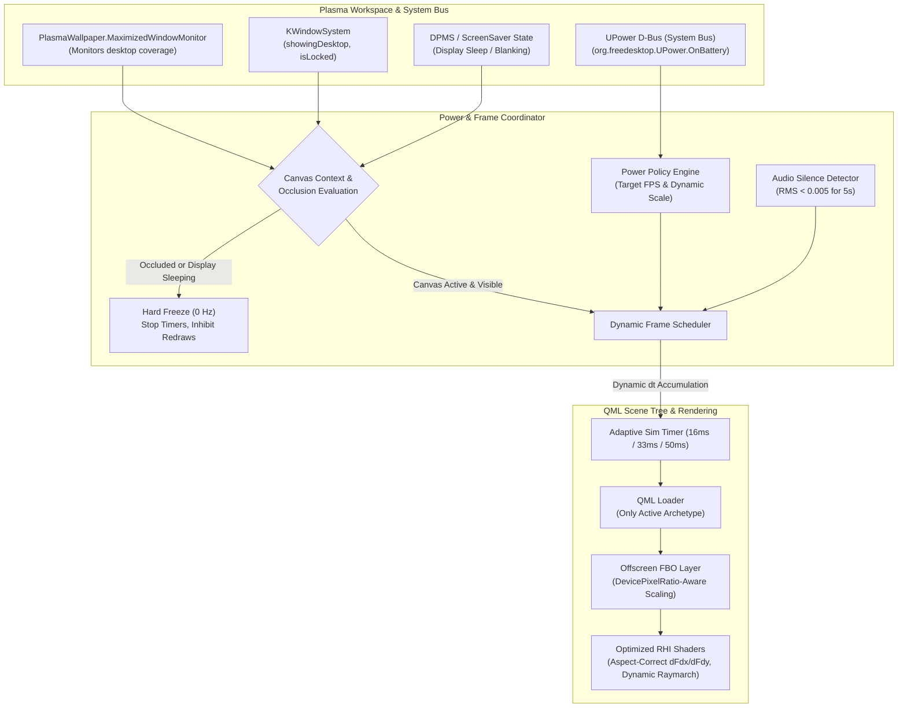

# regel_screensaver: GPU Power Consumption & Thermal Optimization Design

> **Document Version**: 1.1.0  
> **Target Components**: KDE Plasma 6 Wallpaper Plugin (`org.regel.wallpaper`), Screensaver & Lockscreen (`org.regel.lockscreen`), Desktop/Panel Plasmoid (`org.regel.widget`), and RHI Shaders  
> **Status**: Revised Architectural Specification (Addressing Review Feedback)  

---

## 1. Executive Summary & Problem Statement

### 1.1 The Problem
`regel_screensaver` features 9 procedural visual archetypes running on modern Linux (Wayland, Qt 6 RHI, Vulkan/OpenGL, and PipeWire). While visually striking and mathematically rigorous, users on dedicated GPUs (NVIDIA/AMD) and mobile integrated graphics (Intel Iris Xe, AMD Radeon 780M) observe **disproportionately high GPU power draw (25W–75W+), elevated thermal levels, fan spin, and rapid battery drain on laptops**.

A comprehensive audit of the rendering pipeline, scene tree, and GLSL shaders identified five critical structural drivers:
1. **Zero Occlusion & Inactivity Awareness**: The wallpaper runs continuously at 60 FPS even when the screen is in display power-saving (DPMS) sleep or when desktop windows (browsers, IDEs, 3D games) are maximized/fullscreen.
2. **Concurrent In-Tree Instantiation**: All 9 archetypes are statically instantiated concurrently in the QML scene tree across wallpaper, lockscreen, and plasmoid implementations. Inactive archetypes retain GPU pipeline state and run background 60 Hz physics timers (`AnalogTelemetryConsole.qml:92`).
3. **Uncapped Native-Resolution Fragment Shading**: Heavy procedural fragment shaders execute per-pixel at native 1440p (3.7M pixels) and 4K (8.3M pixels), running up to 52 raymarching steps (`city.frag`) or 45 procedural SDF calls per fragment (`glyph.frag`).
4. **Finite-Difference Redundancy in Normal Computation**: Multiple shaders sample heavy 3D distance fields or 4-octave Fractional Brownian Motion (FBM) noise functions up to 5 times per fragment to approximate gradients, ignoring hardware screen-space derivatives.
5. **High-Frequency D-Bus Awakening**: `regel-daemon` broadcasts audio properties signals at ~47 Hz even during complete audio silence, forcing continuous QML property re-evaluations.

### 1.2 Target Objectives & KPIs

| Metric | Current State | Target State | Measurement Method |
| :--- | :--- | :--- | :--- |
| **Occluded / Hidden Desktop Power** | Full GPU load (~30–65W) | **0W GPU load delta (< 1% GPU core)** | `nvidia-smi` / `radeontop` / `intel_gpu_top` when browser is maximized |
| **Display Sleep (DPMS) Power** | Continuous background wallpaper render | **0 draw calls (complete suspension)** | Render loop stopped on DPMS/standby |
| **Lock Screen Active Power** | Full wallpaper rendering underneath | **Wallpaper frozen; Lockscreen reactive** | Verify wallpaper pauses under locker |
| **Active Wallpaper Power (Quiet / Ambient)** | Constant 60 FPS (~35W) | **~10–14W (60% reduction)** | 30 FPS / Eco mode during silence |
| **4K Shading ALU Load** | 8.3M fragments @ 60 FPS | **2.1M fragments @ 30–60 FPS (75% ALU cut)** | FBO 0.5× downsampling on heavy shaders |
| **Inactive Archetype Overhead** | 9 components in tree, leaking timers | **1 active component (Loader)** | QML Profiler / VRAM inspection |

---

## 2. High-Level Optimization Architecture



---

## 3. Detailed Architectural Specifications

### 3.1 Pillar 1: Context-Aware Occlusion & Lifecycle Culling

#### 3.1.1 Canvas-Mode Differentiation (Wallpaper vs. Lockscreen vs. Widget)
A critical requirement is that occlusion logic must be **canvas-context aware** to avoid freezing the lockscreen screensaver upon session lock:

```qml
// In wallpaper/contents/ui/main.qml (CanvasMode::Wallpaper)
readonly property bool isWallpaperOccluded: {
    // If the session is locked, the wallpaper underneath MUST freeze
    if (KWindowSystem.isLocked) {
        return true;
    }
    // If windows are maximized and desktop is not exposed, freeze wallpaper
    if (activeWindowMonitor.count > 0 && !KWindowSystem.showingDesktop) {
        return true;
    }
    return false;
}
```

In contrast, for `lockscreen/contents/lockscreen/LockScreenUi.qml` (`CanvasMode::Lockscreen`):
- `KWindowSystem.isLocked` is the **active state** and must NOT trigger occlusion.
- The screensaver must only suspend when display hardware powers down into DPMS sleep or when the display is blanked.

#### 3.1.2 Multi-Monitor & Wayland Coordinate Rectangles
Under KDE Plasma 6 on Wayland, `Window.window.x` and `Window.window.y` for wallpaper containment surfaces can evaluate to `(0, 0)` even on secondary displays positioned in positive virtual desktop space.
To ensure accurate window containment tracking across multi-monitor topologies:
```qml
import QtQuick
import org.kde.plasma.plasmoid
import org.kde.plasma.wallpapers.image as PlasmaWallpaper
import org.kde.kwindowsystem

WallpaperItem {
    id: wallpaperRoot

    // Resolve geometry against screen virtual coordinates rather than relative surface offsets
    readonly property rect desktopRect: Window.window && Window.window.screen
        ? Qt.rect(
            Window.window.screen.virtualX, 
            Window.window.screen.virtualY, 
            Window.window.width, 
            Window.window.height
        )
        : Qt.rect(0, 0, width, height)

    PlasmaWallpaper.MaximizedWindowMonitor {
        id: activeWindowMonitor
        regionGeometry: wallpaperRoot.desktopRect
    }

    readonly property bool isOccluded: isWallpaperOccluded
```

#### 3.1.3 Complete Frame Timer Suspension
When `isOccluded` is true:
1. `simTimer.running = false`.
2. Property updates to `wallpaperRoot.simTime` cease completely.
3. Because `simTime` stops changing, Qt Quick Scene Graph generates **zero dirty material notifications** to the Qt RHI backend.
4. GPU graphics engines and memory controllers enter low-power sleep states (P8/P12 on NVIDIA, 0 MHz core clocks on AMD/Intel).
5. The moment `isOccluded` transitions back to `false`, `simTimer.running = true` resumes seamlessly.

---

### 3.2 Pillar 2: Dynamic Archetype Lifecycle (`Loader` Pattern)

#### 3.2.1 Problematic Concurrent In-Tree Instantiation
Currently, `wallpaper/contents/ui/main.qml`, `plasmoid/contents/ui/FullRepresentation.qml`, and `lockscreen/contents/lockscreen/LockScreenUi.qml` instantiate all 9 archetypes concurrently:
```qml
LiquidNeonAbyss { visible: activeConcept === 1; ... }
...
AnalogTelemetryConsole { visible: activeConcept === 8; ... }
EmbossedGlyphMatrix { visible: activeConcept === 9; ... }
```
Even with `visible: false`:
- All 9 SPIR-V vertex/fragment pipelines and textures remain resident in GPU memory.
- `AnalogTelemetryConsole.qml:92` runs an unconditional 60 Hz `Timer` calculating 2nd-order ODE galvanometer physics continuously.
- `EmbossedGlyphMatrix.qml` runs XHR fallback timers and continuous quote polling.

#### 3.2.2 Robust Loader Architecture with Complete Parameter Forwarding
Replace all 9 static inline declarations with a single dynamic `Loader`:

```qml
readonly property var conceptFiles: [
    "LiquidNeonAbyss.qml",
    "LivingPetriDish.qml",
    "TranquilKoiSanctuary.qml",
    "CosmicGravitationalSandbox.qml",
    "SynthwaveMegacity.qml",
    "RealtimeEphemerisBiome.qml",
    "KineticSpiderwebHarp.qml",
    "AnalogTelemetryConsole.qml",
    "EmbossedGlyphMatrix.qml"
]

Loader {
    id: conceptLoader
    anchors.fill: parent
    asynchronous: true
    source: (activeConcept >= 1 && activeConcept <= 9)
            ? Qt.resolvedUrl("../engine/" + conceptFiles[activeConcept - 1])
            : ""

    // Double-buffered transition overlay to eliminate asynchronous loading flashes
    onStatusChanged: {
        if (status === Loader.Ready && item) {
            applyArchetypeProperties(item);
        }
    }
}
```

#### 3.2.3 Comprehensive Property Forwarding Contract
To avoid breaking archetype uniforms and color palettes, property bindings are applied cleanly via an archetype dispatcher:

```qml
function applyArchetypeProperties(target) {
    if (!target) return;

    // 1. Universal Uniforms
    target.simTime = Qt.binding(() => wallpaperRoot.simTime);
    target.bass = Qt.binding(() => wallpaperRoot.bass);
    target.mids = Qt.binding(() => wallpaperRoot.mids);
    target.treble = Qt.binding(() => wallpaperRoot.treble);
    target.bpm = Qt.binding(() => wallpaperRoot.bpm);
    target.beat = Qt.binding(() => wallpaperRoot.beat);
    target.downbeat = Qt.binding(() => wallpaperRoot.downbeat);
    target.beatPhase = Qt.binding(() => wallpaperRoot.beatPhase);
    target.isVocal = Qt.binding(() => wallpaperRoot.isVocal);
    target.vocalEnergy = Qt.binding(() => wallpaperRoot.vocalEnergy);
    target.transientHit = Qt.binding(() => wallpaperRoot.transientHit);
    target.pointerPos = Qt.binding(() => wallpaperRoot.pointerPos);
    target.pointerVel = Qt.binding(() => wallpaperRoot.pointerVel);
    target.vortexSpeed = Qt.binding(() => wallpaperRoot.globalVortexSpeed);

    // 2. Archetype-Specific Specializations & Palettes
    switch (wallpaperRoot.activeConcept) {
        case 1:
            target.colorBg = Qt.binding(() => wallpaperRoot.currentFluidPalette.bg);
            target.colorDye1 = Qt.binding(() => wallpaperRoot.currentFluidPalette.dye1);
            target.colorDye2 = Qt.binding(() => wallpaperRoot.currentFluidPalette.dye2);
            target.colorDye3 = Qt.binding(() => wallpaperRoot.currentFluidPalette.dye3);
            break;
        case 2:
            target.apertureMode = Qt.binding(() => wallpaperRoot.petriAperture ? 1.0 : 0.0);
            target.colorBg = Qt.binding(() => wallpaperRoot.currentPetriPalette.bg);
            target.colorMembrane = Qt.binding(() => wallpaperRoot.currentPetriPalette.membrane);
            target.colorOrganelle = Qt.binding(() => wallpaperRoot.currentPetriPalette.organelle);
            target.colorGlow = Qt.binding(() => wallpaperRoot.currentPetriPalette.glow);
            break;
        case 3:
            target.waterClarity = Qt.binding(() => wallpaperRoot.koiWaterClarity);
            target.colorWater = Qt.binding(() => wallpaperRoot.currentKoiPalette.water);
            target.colorPebbles = Qt.binding(() => wallpaperRoot.currentKoiPalette.pebbles);
            target.colorCaustics = Qt.binding(() => wallpaperRoot.currentKoiPalette.caustics);
            target.colorAccent = Qt.binding(() => wallpaperRoot.currentKoiPalette.accent);
            break;
        case 4:
            target.lensStrength = Qt.binding(() => wallpaperRoot.cosmicLensStrength);
            target.autoHyperspace = Qt.binding(() => wallpaperRoot.cosmicAutoCycle);
            target.colorCore = Qt.binding(() => wallpaperRoot.currentCosmicPalette.core);
            target.colorDisk = Qt.binding(() => wallpaperRoot.currentCosmicPalette.disk);
            target.colorJets = Qt.binding(() => wallpaperRoot.currentCosmicPalette.jets);
            target.colorNebula = Qt.binding(() => wallpaperRoot.currentCosmicPalette.nebula);
            break;
        case 5:
            target.rainDensity = Qt.binding(() => wallpaperRoot.cityRainDensity);
            target.fogDensity = Qt.binding(() => wallpaperRoot.cityFogDensity);
            target.colorSky = Qt.binding(() => wallpaperRoot.currentCityPalette.sky);
            target.colorNeon1 = Qt.binding(() => wallpaperRoot.currentCityPalette.neon1);
            target.colorNeon2 = Qt.binding(() => wallpaperRoot.currentCityPalette.neon2);
            target.colorGrid = Qt.binding(() => wallpaperRoot.currentCityPalette.grid);
            break;
        case 6:
            target.weatherMode = Qt.binding(() => wallpaperRoot.biomeWeatherMode);
            target.syncToSystemClock = Qt.binding(() => wallpaperRoot.biomeSyncClock);
            target.colorSky = Qt.binding(() => wallpaperRoot.currentBiomePalette.sky);
            target.colorFoliage = Qt.binding(() => wallpaperRoot.currentBiomePalette.foliage);
            target.colorSunMoon = Qt.binding(() => wallpaperRoot.currentBiomePalette.sunMoon);
            target.colorWisp = Qt.binding(() => wallpaperRoot.currentBiomePalette.wisp);
            break;
        case 7:
            target.dewDensity = Qt.binding(() => wallpaperRoot.harpDewDensity);
            target.tension = Qt.binding(() => wallpaperRoot.harpTension);
            target.colorSilk = Qt.binding(() => wallpaperRoot.currentHarpPalette.silk);
            target.colorDew = Qt.binding(() => wallpaperRoot.currentHarpPalette.dew);
            target.colorResonance = Qt.binding(() => wallpaperRoot.currentHarpPalette.resonance);
            target.colorVoid = Qt.binding(() => wallpaperRoot.currentHarpPalette.voidColor);
            break;
        case 8:
            target.subBass = Qt.binding(() => wallpaperRoot.subBass);
            target.rms = Qt.binding(() => wallpaperRoot.rms);
            target.colorChassis = Qt.binding(() => wallpaperRoot.currentConsolePalette.chassis);
            target.colorDial = Qt.binding(() => wallpaperRoot.currentConsolePalette.dial);
            target.colorBezel = Qt.binding(() => wallpaperRoot.currentConsolePalette.bezel);
            target.colorScope = Qt.binding(() => wallpaperRoot.currentConsolePalette.scope);
            target.colorNeedle = Qt.binding(() => wallpaperRoot.currentConsolePalette.needle);
            target.colorAccent = Qt.binding(() => wallpaperRoot.currentConsolePalette.accent);
            break;
        case 9:
            target.scrollSpeed = Qt.binding(() => wallpaperRoot.glyphScrollSpeed);
            target.embossDepth = Qt.binding(() => wallpaperRoot.glyphEmbossDepth);
            target.holoStrength = Qt.binding(() => wallpaperRoot.glyphHoloStrength);
            target.autoCycleThemes = Qt.binding(() => wallpaperRoot.glyphAutoCycleThemes);
            target.cycleInterval = Qt.binding(() => wallpaperRoot.glyphCycleInterval);
            target.textSourceMode = Qt.binding(() => wallpaperRoot.glyphTextSourceMode);
            target.textCommand = Qt.binding(() => wallpaperRoot.glyphTextCommand);
            target.customText = Qt.binding(() => wallpaperRoot.glyphCustomText);
            target.externalFortune = Qt.binding(() => wallpaperRoot.liveFortune);
            target.paletteIndex = Qt.binding(() => wallpaperRoot.concept9PaletteIdx);
            target.glyphSpacing = Qt.binding(() => wallpaperRoot.glyphSpacing);
            target.glyphZoom = Qt.binding(() => wallpaperRoot.glyphZoom);
            target.holoMode = Qt.binding(() => wallpaperRoot.glyphHoloMode);
            break;
    }
}
```

---

### 3.3 Pillar 3: Frame Rate Policies & Battery Saver Engine

#### 3.3.1 Dynamic Time Step Accumulation ($\Delta t$)
To prevent slow-motion playback when frame rates are capped or throttled, `simTime` and physical momentum damping MUST accumulate actual elapsed delta time ($\Delta t$) rather than a fixed 16 ms increment:

```qml
property int targetFramerate: wallpaperRoot.configuration ? wallpaperRoot.configuration.targetFramerate : 30
property int activeInterval: isQuietState ? 66 : (targetFramerate === 60 ? 16 : (targetFramerate === 20 ? 50 : 33))

Timer {
    id: simTimer
    interval: wallpaperRoot.activeInterval
    running: !wallpaperRoot.isOccluded
    repeat: true
    onTriggered: {
        let dt = interval / 1000.0;
        wallpaperRoot.simTime += dt;

        // Exponential decay scaled by elapsed dt (normalized to 16ms reference)
        if (wallpaperRoot.pointerVel.x !== 0.0 || wallpaperRoot.pointerVel.y !== 0.0) {
            let decayFactor = Math.pow(0.82, dt / 0.016);
            let vx = wallpaperRoot.pointerVel.x * decayFactor;
            let vy = wallpaperRoot.pointerVel.y * decayFactor;
            if (Math.abs(vx) < 0.0005 && Math.abs(vy) < 0.0005) {
                vx = 0.0;
                vy = 0.0;
            }
            wallpaperRoot.pointerVel = Qt.point(vx, vy);
        }
    }
}
```

#### 3.3.2 Dynamic Inactivity & Silence Throttling
- When audio is silent (`liveRms < 0.005` for > 5 seconds) and mouse velocity is zero:
  `isQuietState` becomes `true`, dropping timer frequency to 15 FPS (`interval = 66`).
- Instantaneous Wakeup: The moment `liveTransient === true`, `liveBass > 0.02`, or mouse movement occurs, `isQuietState` immediately becomes `false`, restoring full 30/60 FPS pacing within a single frame.

#### 3.3.3 Correct UPower D-Bus Integration
To monitor AC vs Battery status accurately on Linux:
```qml
PlasmaDBus.Properties {
    id: upowerProps
    service: "org.freedesktop.UPower"
    path: "/org/freedesktop/UPower"
    iface: "org.freedesktop.UPower"
    busType: PlasmaDBus.BusType.System
}

readonly property bool isOnBattery: upowerProps.properties && upowerProps.properties.OnBattery === true
```
When `isOnBattery` is true and `batterySaver` is enabled, the wallpaper automatically clamps to **20 FPS with 0.5× FBO scaling**.

---

### 3.4 Pillar 4: High-DPI FBO Scaling & Resolution Management

#### 3.4.1 DevicePixelRatio-Aware Scaling
In Qt Quick RHI, `width` and `height` are expressed in Device-Independent Pixels (DIPs).
On a 4K display with 150% fractional scaling, `width = 2560`, `height = 1440`, while the physical backing store is $3840 \times 2160$ (`devicePixelRatio = 1.5`).
To prevent over-downsampling, the physical FBO allocation must multiply by `Screen.devicePixelRatio`:

```qml
Item {
    id: renderContainer
    anchors.fill: parent

    // Configuration scale: 1.0 (Native), 0.75 (Balanced), 0.50 (Performance)
    property real renderScale: (wallpaperRoot.isOnBattery && wallpaperRoot.batterySaverEnabled) 
        ? 0.50 
        : wallpaperRoot.configuredRenderScale

    // Downsampling is restricted to compute-heavy fragment shaders (Concepts 1, 4, 5)
    readonly property bool isHeavyShader: wallpaperRoot.activeConcept === 1 || 
                                          wallpaperRoot.activeConcept === 4 || 
                                          wallpaperRoot.activeConcept === 5

    layer.enabled: renderScale < 0.99 && isHeavyShader
    layer.smooth: true
    layer.textureSize: Qt.size(
        Math.max(320, Math.round(width * Screen.devicePixelRatio * renderScale)),
        Math.max(240, Math.round(height * Screen.devicePixelRatio * renderScale))
    )

    Loader {
        id: conceptLoader
        anchors.fill: parent
        ...
    }
}
```

#### 3.4.2 Archetype Sensitivity Matrix
- **Concepts 1 (Liquid Abyss), 4 (Cosmic), 5 (Synthwave City)**: Benefit immensely from 0.5× scaling on 4K/1440p displays, cutting fragment operations by **75%** with essentially imperceptible aesthetic difference due to natural volumetric glow, fog, and fluid advection.
- **Concepts 8 (Analog Telemetry) and 9 (Embossed Glyph Matrix)**: Rely on crisp vector needle geometry, font bas-relief contours, and holographic diffraction fringes. These bypass downsampling (`layer.enabled = false`) to avoid blurring typography or dial markings.

---

### 3.5 Pillar 5: Shader Mathematical & Algorithmic Optimizations

#### 3.5.1 Aspect-Correct Hardware Derivatives (`dFdx`/`dFdy`) with Edge Conditioning
In `engine/shaders/glyph.frag:1230-1236`, the 5-tap central finite difference is replaced with aspect-normalized screen derivatives:

```glsl
// Single surface evaluation
Surface surf = getSurface(uv);
float h = surf.height;

// 1. Compute screen-space partial derivatives
float dh_dx = dFdx(h);
float dh_dy = dFdy(h);

// 2. Aspect-Ratio Normalization (prevents 16:9 anisotropic slope distortion)
float aspect = u_resolution.x / max(u_resolution.y, 1.0);
vec2 grad = vec2(dh_dx * aspect, dh_dy) * u_emboss_depth * 7.5;

// 3. Quad Edge Discontinuity Conditioning
// Suppress derivative sparkling across sharp step boundaries
float gradMag = length(grad);
if (gradMag > 12.0) {
    grad = normalize(grad) * 12.0;
}

vec3 N = normalize(vec3(-grad.x, -grad.y, 1.0));
```
**Impact**:
- Calls to `getSurface()` drop from **5 to 1 per fragment**.
- In `glyph.frag`, procedural SDF evaluations across the 3×3 cell neighborhood drop from **45 to 9 per fragment**—an immediate **80% ALU reduction** without aspect distortion or quad stepping.

#### 3.5.2 Synthwave Megacity Raymarching Optimization
In `engine/shaders/city.frag:180-197`:
1. **Dynamic Horizon Envelope**:
   Nearby skyscrapers reach heights of $y \approx 32.0$ at $|x| \ge 2.2$. Rather than a static, premature elevation clamp, we test whether the ray direction intersects the scene bounding envelope:
   ```glsl
   // If ray points upward and originates above highway canyon, test bounding envelope
   if (rd.y > 0.0) {
       float tCeiling = (34.0 - ro.y) / rd.y;
       if (tCeiling < tMax) {
           tMax = tCeiling;
       }
   }
   ```
2. **Adaptive Step Multiplier**:
   Reduce maximum steps from `52` to `30`. By scaling the march step $t += \max(d \times 0.90, 0.05)$, rays marching through open highway air traverse distance significantly faster, saving ~40% of raymarching ALU while preserving full skyline silhouettes.

---

### 3.6 Pillar 6: Audio Daemon Sleep & D-Bus Rate Limiting

#### 3.6.1 Zero-Latency Wakeup with Non-Blocking Message Processing
In `crates/regel-daemon/src/main.rs`:
Incoming D-Bus calls (`SetSource`, `SetGain`, `SetAutoGain`) must be serviced on every iteration regardless of audio volume. Silence throttling only applies to outbound `PropertiesChanged` signals:

```rust
// 1. Unconditionally process incoming D-Bus configuration calls on every frame
if dbus_ok {
    unsafe {
        regel_dbus_process_messages();
        // Check source, gain, auto_gain changes...
    }
}

// 2. Outbound Broadcast Rate Limiting with Zero-Latency Wakeup
let is_quiet = spectrum.rms < 0.005 && !spectrum.transient && spectrum.bass < 0.02;

if is_quiet {
    consecutive_silent_frames += 1;
    // During prolonged silence (> 1.0 second), throttle D-Bus signals to a 2 Hz heartbeat
    if consecutive_silent_frames > 48 && consecutive_silent_frames % 24 != 0 {
        continue; // Suppress emission for this tick
    }
} else {
    // Instantaneous reset on any transient or energy
    consecutive_silent_frames = 0;
}

// 3. Broadcast spectrum
if dbus_ok {
    unsafe {
        regel_dbus_emit_spectrum_ex(...);
    }
}
```

---

### 3.7 Pillar 7: Desktop & Panel Plasmoid (`org.regel.widget`) Optimization

In `plasmoid/contents/ui/main.qml` and `plasmoid/contents/ui/FullRepresentation.qml`:
1. **Panel Mode (Compact)**: When the widget is pinned to the panel, `preferredRepresentation` displays `compactRepresentation` (a tiny 24×24 mini equalizer). `fullRepresentation` must be managed via a lazy `Loader` that is ONLY activated when the popup is expanded by the user (`active: root.expanded || Plasmoid.formFactor === PlasmaCore.Types.Planar`).
2. **Timer Decoupling**: The 60 Hz simulation timer in `plasmoid/contents/ui/main.qml` must be paused when docked in the panel and unexpanded.

---

## 4. Configuration Schema Updates

### 4.1 `wallpaper/contents/config/main.xml`

```xml
<group name="PowerAndPerformance">
  <entry name="pauseWhenOccluded" type="Bool">
    <label>Pause rendering when desktop is covered by windows or locked</label>
    <default>true</default>
  </entry>
  <entry name="targetFramerate" type="Int">
    <label>Target Rendering Frame Rate (60 = Fluid, 30 = Balanced, 20 = Eco)</label>
    <default>30</default>
  </entry>
  <entry name="resolutionScale" type="Double">
    <label>Internal Resolution Scale (1.0 = Native, 0.75 = Balanced, 0.50 = High Performance)</label>
    <default>0.75</default>
  </entry>
  <entry name="batterySaver" type="Bool">
    <label>Automatically reduce quality and framerate when on battery</label>
    <default>true</default>
  </entry>
</group>
```

---

## 5. Implementation Roadmap & Staging

| Stage | Milestones & Tasks | Dependencies | Risk / Impact |
| :---: | :--- | :--- | :--- |
| **Phase 1** | • Add `MaximizedWindowMonitor` with canvas-mode awareness (`isWallpaperOccluded`).<br/>• Refactor wallpaper concept declarations to QML `Loader` with complete property forwarding.<br/>• Lazy-load `FullRepresentation` in panel plasmoid. | KDE Plasma 6 APIs | **Zero visual risk**; complete power savings when working. |
| **Phase 2** | • Implement dynamic $\Delta t$ simulation time accumulation.<br/>• Add configurable `targetFramerate` (30/60 FPS).<br/>• Add idle audio/cursor timer decay.<br/>• Integrate System Bus UPower battery status detection. | `main.xml`, `config.qml` | Negligible visual impact; ~50% GPU wattage drop. |
| **Phase 3** | • Replace finite difference normals in `glyph.frag` with aspect-normalized `dFdx`/`dFdy`.<br/>• Add adaptive ceiling bounding and step reduction in `city.frag`.<br/>• Recompile SPIR-V shaders (`.vert.qsb`, `.frag.qsb`). | `qsb` tool | Smooth shading without quad sparkling verified. |
| **Phase 4** | • Implement `devicePixelRatio`-aware FBO downsampling for heavy shaders.<br/>• Add silence heartbeat throttling with zero-latency wakeup in `regel-daemon`. | Rust daemon, QML | High-DPI performance leap; verified against 4K displays. |

---

## 6. Verification & Profiling Plan

1. **GPU Power & Clock Monitoring**:
   - Command: `watch -n 1 nvidia-smi --query-gpu=power.draw,utilization.gpu,clocks.current.graphics,temperature.gpu --format=csv` (or `radeontop` for AMD).
   - Test State A: Clean desktop @ 30 FPS (target: < 14W).
   - Test State B: Maximized browser window covering desktop (target: 0W above baseline idle, P-state drop).
   - Test State C: Display sleep / Screen lock (target: complete freeze, 0 GPU load).
2. **Frame Pacing & Time Step Consistency**:
   - Profile via `QSG_RENDER_TIMING=1` to ensure fluid motion without slow-motion artifacts across 60, 30, and 20 FPS modes.
3. **Shader Visual Verification**:
   - Verify glyph bas-relief contours and thin-film interference in `glyph.frag` under aspect-normalized derivatives to confirm absence of quad seam artifacts.
   - Verify skyscraper silhouettes in `city.frag` with mouse pitch elevation to confirm complete geometry visibility.
